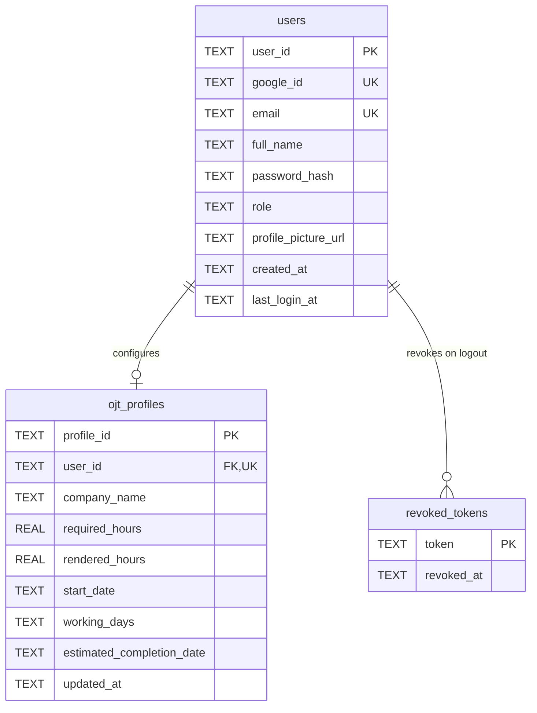

# InternLog: Project Summary & Technical Documentation

**Repository:** `https://github.com/Pochyy/InternLog.git`  
**Course:** IT342 — Systems Integration and Architecture 1  
**Project Name:** InternLog: A Smart OJT Journal and Hours Tracking System  
**Current Milestone:** Project Development Increment 2 — User Profile Management, Reset Password, and Change Password (extending Increment 1 Core Auth & Dashboard)  
**Last Updated:** November 25, 2026  

---

## 1. Executive Summary & Purpose

**InternLog** is a web-based On-the-Job Training (OJT), practicum, and internship management platform built to assist students in tracking their training hours, configuring their host placement parameters, keeping daily work activity logs, and generating verified reports.

The system is designed strictly in accordance with the approved **InternLog Software Requirements Specification (SRS)**:
* **Single Primary Role Scope:** Focused exclusively on the **Registered OJT Student (`student`)** role (SRS Sections 1.5, 1.6, and 2.2).
* **Increment 1 Objective:** Deliver complete account creation, secure credential verification, JWT session management with server-side revocation on logout, role-based access control (RBAC), and an interactive student dashboard featuring OJT placement configuration and dynamic hours forecasting.

---

## 2. Technology Stack & Architecture

### 2.1 Architectural Pattern
InternLog utilizes a decoupled **Client-Server RESTful Architecture**:
* **Frontend:** Single-page application (SPA) built with React 18 and Vite.
* **Backend:** REST API service built with Node.js and Express.js.
* **Database Engine:** Relational SQLite via `sql.js` (WebAssembly/pure JavaScript engine) that maintains persistent binary state at `backend/data/internlog.db`.

```
┌────────────────────────────────────────────────────────┐
│                   React 18 SPA (Vite)                  │
│  - React Router v6 (ProtectedRoute RBAC Guard)         │
│  - AuthContext State & LocalStorage JWT Storage        │
│  - Bento Grid Dashboard & Split-Screen Showcase UI     │
└───────────────────────────┬────────────────────────────┘
                            │
               HTTP / REST API (JSON)
               Authorization: Bearer <JWT>
                            │
┌───────────────────────────▼────────────────────────────┐
│                  Express.js Backend API                │
│  - CORS & JSON Body Parser                             │
│  - authenticateToken & requireRole Middleware          │
│  - authController & profileController                  │
└───────────────────────────┬────────────────────────────┘
                            │
               Relational Database Operations
                            │
┌───────────────────────────▼────────────────────────────┐
│             SQLite Relational Engine (sql.js)          │
│  - Tables: users, ojt_profiles, revoked_tokens         │
│  - File: backend/data/internlog.db                     │
└────────────────────────────────────────────────────────┘
```

### 2.2 Tech Stack Breakdown

| Domain | Technology / Library | Version | Description / Purpose |
| :--- | :--- | :--- | :--- |
| **Frontend Framework** | React | `^18.3.1` | Declarative UI component library |
| **Build Tool & Dev Server**| Vite | `^5.4.2` | High-speed frontend bundling and HMR |
| **Frontend Routing** | React Router DOM | `^6.26.2` | Client-side routing, protected guards, navigation |
| **Styling & Design** | Vanilla CSS (CSS Variables) | Modern | Custom Bento Grid, Productivity Teal & Amber palette |
| **Backend Runtime** | Node.js | `>=18.0.0` | Server-side JavaScript runtime |
| **Web Framework** | Express.js | `^4.19.2` | RESTful routing, middleware, controllers |
| **Database** | `sql.js` (SQLite) | `^1.10.3` | Relational SQLite database with disk persistence |
| **Password Hashing** | `bcryptjs` | `^2.4.3` | 10-round salted one-way password hashing |
| **Authentication** | `jsonwebtoken` (JWT) | `^9.0.2` | Signed stateless token issuance & verification |
| **Cross-Origin Handling** | `cors` | `^2.8.5` | Cross-Origin Resource Sharing policy |
| **Environment Config** | `dotenv` | `^16.4.5` | Environment variable management |

---

## 3. Directory & File Manifest

```text
InternLog/
├── backend/
│   ├── data/
│   │   └── internlog.db              # SQLite binary database file (auto-created on startup)
│   ├── src/
│   │   ├── config/
│   │   │   └── db.js                 # SQLite database initialization, schema DDL, query helpers
│   │   ├── controllers/
│   │   │   ├── authController.js     # User registration, login, logout, and getMe handlers
│   │   │   └── profileController.js  # OJT profile upsert, retrieval, and completion forecasting
│   │   ├── middleware/
│   │   │   └── auth.js               # authenticateToken (JWT check + revocation) & requireRole RBAC
│   │   ├── routes/
│   │   │   ├── authRoutes.js         # Routes for /api/auth/*
│   │   │   └── profileRoutes.js      # Routes for /api/profile/*
│   │   └── server.js                 # Server entry point, middleware assembly, DB bootstrap
│   ├── .env.example                  # Backend environment variable template
│   ├── package.json                  # Backend dependencies and scripts
│   └── package-lock.json
├── frontend/
│   ├── public/                       # Static public assets
│   ├── src/
│   │   ├── components/
│   │   │   ├── Navbar.jsx            # Top navigation bar with user avatar, role badge, and logout
│   │   │   ├── OjtSetupModal.jsx     # Modal for configuring or editing OJT placement parameters
│   │   │   └── ProtectedRoute.jsx    # Guard component enforcing authentication & RBAC roles
│   │   ├── context/
│   │   │   └── AuthContext.jsx       # Global authentication provider and session restoration
│   │   ├── pages/
│   │   │   ├── Login.jsx             # Split-screen user login interface with feature showcase
│   │   │   ├── Register.jsx          # Split-screen user registration interface with form validation
│   │   │   └── StudentDashboard.jsx  # Bento Grid student workspace, metrics, and progress tracking
│   │   ├── api.js                    # Fetch utility with base URL and Bearer token attachment
│   │   ├── App.jsx                   # Application router and top-level layout
│   │   ├── index.css                 # Responsive stylesheet, CSS tokens, and Bento grid styles
│   │   └── main.jsx                  # React DOM entry point
│   ├── index.html                    # HTML document wrapper with Inter font
│   ├── package.json                  # Frontend dependencies and scripts
│   ├── package-lock.json
│   └── vite.config.js                # Vite build and plugin configuration
├── .gitignore                        # Git ignore rules for node_modules, .env, and *.db
├── README.md                         # Official project README with quickstart instructions
├── PROJECT_SUMMARY.md                # (This file) Comprehensive technical overview and codebase reference
└── AI_CONTINUATION.md                # Persistent AI assistant handoff and session activity ledger
```

---

## 4. Database Schema & Relational Design

The database uses SQLite managed through `backend/src/config/db.js` with foreign key enforcement (`PRAGMA foreign_keys = ON`).

### 4.1 Tables

#### 1. `users` Table
Stores authenticated student account records.
```sql
CREATE TABLE IF NOT EXISTS users (
  user_id TEXT PRIMARY KEY,
  google_id TEXT UNIQUE,
  email TEXT UNIQUE NOT NULL,
  full_name TEXT NOT NULL,
  password_hash TEXT NOT NULL,
  role TEXT NOT NULL DEFAULT 'student',
  profile_picture_url TEXT,
  created_at TEXT NOT NULL,
  last_login_at TEXT
);
```

#### 2. `ojt_profiles` Table
Stores the student's internship placement parameters and dynamic forecast metadata (SRS FR-1.4, FR-1.5, FR-2.4, FR-2.5).
```sql
CREATE TABLE IF NOT EXISTS ojt_profiles (
  profile_id TEXT PRIMARY KEY,
  user_id TEXT UNIQUE NOT NULL,
  company_name TEXT NOT NULL,
  required_hours REAL NOT NULL DEFAULT 300,
  rendered_hours REAL NOT NULL DEFAULT 0,
  start_date TEXT NOT NULL,
  working_days TEXT NOT NULL DEFAULT 'Monday,Tuesday,Wednesday,Thursday,Friday',
  estimated_completion_date TEXT,
  updated_at TEXT NOT NULL,
  FOREIGN KEY (user_id) REFERENCES users(user_id) ON DELETE CASCADE
);
```

#### 3. `revoked_tokens` Table
Maintains a blocklist of revoked JWT tokens upon explicit user logout, mitigating stateless token replay vulnerabilities.
```sql
CREATE TABLE IF NOT EXISTS revoked_tokens (
  token TEXT PRIMARY KEY,
  revoked_at TEXT NOT NULL
);
```

### 4.2 Entity Relationship Diagram (ERD)



---

## 5. API Specification & Endpoints

Base URL: `http://localhost:5000/api`

### 5.1 Endpoint Matrix

| Method | Endpoint | Access | Required Headers | Description |
| :--- | :--- | :--- | :--- | :--- |
| `GET` | `/health` | Public | None | API health status check |
| `POST` | `/auth/register` | Public | None | Register new student account |
| `POST` | `/auth/login` | Public | None | Authenticate student & receive JWT |
| `POST` | `/auth/logout` | Protected | `Authorization: Bearer <token>` | Invalidate JWT session in revoked list |
| `GET` | `/auth/me` | Protected | `Authorization: Bearer <token>` | Get authenticated user info & profile |
| `PUT` | `/auth/change-password` | Protected | `Authorization: Bearer <token>` | Verify current password, update bcrypt hash & rotate JWT |
| `POST` | `/auth/forgot-password` | Public | None | Verify email & generate 15-min single-use SHA-256 token |
| `GET` | `/auth/verify-reset-token` | Public | None | Validate whether recovery token exists, is unused & unexpired |
| `POST` | `/auth/reset-password` | Public | None | Consume recovery token & save new 10-round bcrypt password |
| `GET` | `/users/profile` | Protected (`student`) | `Authorization: Bearer <token>` | Retrieve student personal & academic profile |
| `PUT` | `/users/profile` | Protected (`student`) | `Authorization: Bearer <token>` | Update own profile (enforces `403` cross-user isolation) |
| `GET` | `/profile` | Protected (`student`) | `Authorization: Bearer <token>` | Retrieve OJT profile & computed metrics |
| `PUT` | `/profile` | Protected (`student`) | `Authorization: Bearer <token>` | Create or update OJT parameters |

### 5.2 Key Payload Structures

#### Account Registration (`POST /api/auth/register`)
* **Request Body:**
  ```json
  {
    "full_name": "Juan Dela Cruz",
    "email": "juan.delacruz@student.edu.ph",
    "password": "Password123!",
    "confirm_password": "Password123!"
  }
  ```
* **Success Response (`201 Created`):**
  ```json
  {
    "success": true,
    "message": "Account created successfully.",
    "data": {
      "token": "eyJhbGciOi...",
      "user": {
        "user_id": "uuid-v4",
        "full_name": "Juan Dela Cruz",
        "email": "juan.delacruz@student.edu.ph",
        "role": "student",
        "profile_picture_url": "https://ui-avatars.com/api/?...",
        "created_at": "2026-11-24T06:36:00.000Z",
        "last_login_at": "2026-11-24T06:36:00.000Z"
      },
      "ojt_profile": null
    }
  }
  ```

#### OJT Placement Setup / Update (`PUT /api/profile`)
* **Request Body:**
  ```json
  {
    "company_name": "Acme Tech Solutions Inc.",
    "required_hours": 486,
    "start_date": "2026-11-25",
    "working_days": "Monday,Tuesday,Wednesday,Thursday,Friday"
  }
  ```
* **Success Response (`200 OK`):**
  ```json
  {
    "success": true,
    "message": "OJT Profile configuration saved successfully.",
    "data": {
      "ojt_profile": {
        "profile_id": "uuid-v4",
        "user_id": "uuid-v4",
        "company_name": "Acme Tech Solutions Inc.",
        "required_hours": 486,
        "rendered_hours": 0,
        "start_date": "2026-11-25",
        "working_days": "Monday,Tuesday,Wednesday,Thursday,Friday",
        "estimated_completion_date": "2027-02-18",
        "updated_at": "2026-11-24T06:40:00.000Z"
      },
      "metrics": {
        "required_hours": 486,
        "rendered_hours": 0,
        "remaining_hours": 486,
        "completion_percentage": 0,
        "estimated_completion_date": "2027-02-18"
      }
    }
  }
  ```

---

## 6. Frontend Architecture & Design System

### 6.1 Design Principles
* **Design Aesthetic:** Modern SaaS "Pro Max" design featuring a **Bento Grid** structure on the student dashboard and a **Split-Screen Layout** on authentication views.
* **Color Palette (CSS Variables):**
  * Primary Teal: `#0D9488` (Dark: `#134E4A`, Light: `#CCFBF1`)
  * Warm Amber Accent: `#F59E0B` (Text: `#B45309`, Light: `#FEF3C7`)
  * Neutral Slate: `#0F172A` (Text: `#334155`, Border: `#E2E8F0`, Surface: `#FFFFFF`, Background: `#F8FAFC`)
* **Typography:** Inter (`sans-serif`), 100% responsive down to 360px mobile viewports.

### 6.2 Bento Grid Layout on `/dashboard`
1. **Tile 1 (Span 8):** Hero Welcome Banner with dynamic progress bar and quick setup button.
2. **Tile 2 (Span 4):** Estimated Completion Date spotlight with host company summary badge.
3. **Tile 3 (Span 3):** Target Required Hours metric card.
4. **Tile 4 (Span 3):** Hours Rendered metric card (auto-synced with approved logs).
5. **Tile 5 (Span 3):** Hours Remaining balance calculation.
6. **Tile 6 (Span 3):** Active Working Days schedule counter.
7. **Tile 7 (Span 6):** OJT Placement & Student Profile summary with edit trigger.
8. **Tile 8 (Span 6):** Workspace Features & Tools roadmap card highlighting active and upcoming modules.

---

## 7. Security Implementation

1. **Password Protection:** Uses `bcryptjs` with 10 salt rounds. Plaintext passwords never touch persistence.
2. **Stateless JWT with State Revocation:** JWTs signed with `JWT_SECRET` (default 24h expiration). Upon logout, tokens are persisted in `revoked_tokens` so intercepted or cached tokens cannot be reused.
3. **Strict RBAC Enforcement:** Both frontend (`ProtectedRoute`) and backend (`requireRole('student')`) strictly reject access from unauthorized roles.
4. **Input Sanitization & Constraints:**
   * Email regex check and lowercase normalization.
   * Unique constraint on emails to prevent race-condition duplications.
   * Upper bounds on hours (1 to 2000 hours max) to prevent invalid data.
   * Safe SQLite parameter binding (`stmt.bind(params)`) to eliminate SQL injection.

---

## 8. Current Implementation Status vs. Roadmap

| Increment | Feature / Module | Status | Notes |
| :--- | :--- | :--- | :--- |
| **Increment 1** | User Registration & Input Validation | **Complete** | Bcrypt hashing, email regex, duplicate checks |
| **Increment 1** | User Login & JWT Session Management | **Complete** | Sign-in, Bearer tokens, /api/auth/me |
| **Increment 1** | Session Termination (Logout) | **Complete** | Token revocation blocklist in SQLite |
| **Increment 1** | Role-Based Access Control (RBAC) | **Complete** | `student` role enforced across frontend & API |
| **Increment 1** | OJT Placement Onboarding (`FR-1.4`/`1.5`) | **Complete** | Company name, required hours, schedule |
| **Increment 1** | Hours & Progress Forecasting (`FR-2.4`/`2.5`) | **Complete** | Remaining hours, % completion, end date forecast |
| **Increment 2** | User Profile Management (`/profile`) | **Complete** | View/edit Name, Email, Student ID, Contact, Program; anti-IDOR `403` |
| **Increment 2** | Reset Password / Forgot Password | **Complete** | SHA-256 hashed 15-min single-use tokens + Dev Recovery Notification |
| **Increment 2** | Authenticated Change Password | **Complete** | Current password bcrypt verification, non-reuse, JWT rotation |
| **Increment 2** | Increment 2 Completion Report PDF | **Complete** | Saved at `docs/Increment-2-Completion-Report.pdf` |
| **Increment 3** | Daily Time In / Time Out Log (`FR-2.1`) | *Planned* | Daily shift logging, lunch break deductions |
| **Increment 3** | Smart Daily Work Journal (`FR-3.1`) | *Planned* | Rich-text daily activity notes |
| **Increment 3** | AI Journal Polisher (`FR-3.3`) | *Planned* | LLM prompt integration to polish student entries |
| **Increment 4** | Weekly Report Generation (`FR-4.1`) | *Planned* | Aggregate daily logs into weekly format |
| **Increment 4** | Printable PDF Export (`FR-4.5`) | *Planned* | School-ready PDF export of signed timesheets |
